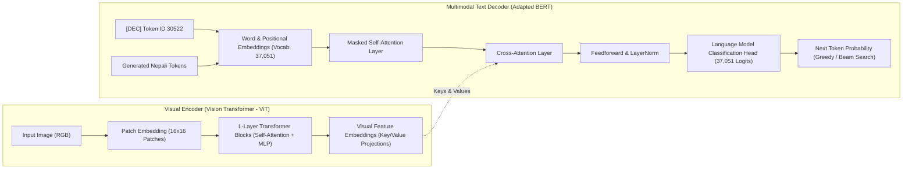
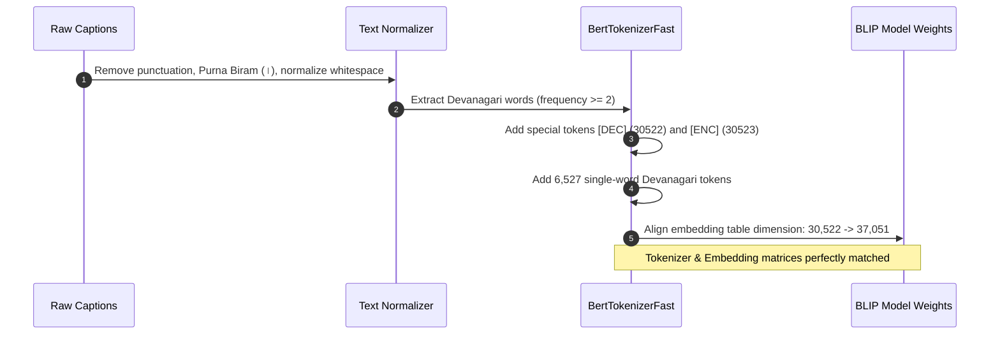

# 🇳🇵 Nepali Image Captioning with Adapted BLIP

An end-to-end deep learning project adapting Salesforce's **BLIP (Bootstrapping Language-Image Pre-training)** to generate accurate, natural, and context-aware captions for images in the **Nepali (नेपाली)** language.

---

## 📑 Table of Contents

- [Project Overview](#-project-overview)
- [Key Innovations & What's New](#-key-innovations--whats-new)
- [Overall Architecture & Flowcharts](#-overall-architecture--flowcharts)
  - [1. End-to-End System Pipeline](#1-end-to-end-system-pipeline)
  - [2. Model Architecture & Cross-Attention Mechanics](#2-model-architecture--cross-attention-mechanics)
  - [3. Tokenizer Adaptation Pipeline](#3-tokenizer-adaptation-pipeline)
- [Dataset Details & Preprocessing](#-dataset-details--preprocessing)
- [Experimental Results & Benchmarks](#-experimental-results--benchmarks)
- [How to Train, Run, and Test](#-how-to-train-run-and-test)
  - [Prerequisites & Installation](#prerequisites--installation)
  - [Inference on Images](#inference-on-images)
  - [Python API Usage](#python-api-usage)
  - [Training Workflow](#training-workflow)
- [Project Structure](#-project-structure)
- [Research Directions & Novel Q1 Publication Roadmap](#-research-directions--novel-q1-publication-roadmap)

---

## 🌟 Project Overview

Vision-Language Pre-training (VLP) models such as BLIP are pre-trained predominantly on massive English datasets (e.g., COCO, Visual Genome, LAION). Consequently, out-of-the-box models fail completely when tasked with low-resource languages written in non-Latin scripts, such as **Nepali (Devanagari script)**:

- English tokenizers segment Devanagari words into meaningless byte fragments or generic `[UNK]` tokens.
- Cross-attention layers and text decoders cannot map visual feature representations into coherent Nepali syntactic structures.

This project solves this bottleneck by taking **`Salesforce/blip-image-captioning-base`** and conducting **vocabulary adaptation**, **Devanagari diacritic preservation**, and **discriminative fine-tuning** on an image-level partitioned Nepali dataset. The resulting model produces fluent, grammatically sound Devanagari image descriptions with high semantic fidelity.

---

## 💡 Key Innovations & What's New

Unlike naive fine-tuning attempts, this project implements several specialized engineering and algorithmic techniques:

1. **Custom Devanagari Vocabulary Expansion (+6,527 Tokens)**:
   - Extracted high-frequency Devanagari words from the corpus (matching regex `^[\u0900-\u097F]+$`, frequency $\ge 2$, capped at 8,000 candidates).
   - Expanded the tokenizer vocabulary from 30,522 to **37,051 tokens**, drastically reducing the unknown token rate (`[UNK]`) and subword fragmentation.
2. **Preservation of Devanagari Diacritics (`strip_accents=False`)**:
   - Standard BERT tokenizers strip accent marks by default, corrupting Devanagari vowel signs (_matras_ such as `ा`, `ि`, `ी`, `ु`, `े`, `ो`, `ौ`, and halant `्`). Setting `strip_accents=False` preserves Devanagari orthography.
3. **BLIP Special Token ID Collision Protection**:
   - BLIP's pretrained decoder reserves token ID `30522` as `[DEC]` (decoder start/BOS token) and `30523` as `[ENC]`.
   - Naively injecting tokens would overwrite these critical IDs. The adaptation pipeline explicitly registers `[DEC]` and `[ENC]` in the tokenizer first, ensuring newly added Nepali words receive IDs $\ge 30524$.
4. **Differential / Two-Tier Learning Rates**:
   - **New Token Embeddings & LM Head**: Trained at a higher rate (`1e-4`) to learn meaningful semantic representations for the newly initialized Devanagari tokens quickly.
   - **Backbone (ViT Encoder + Transformer Layers)**: Trained at a conservative rate (`1e-5`) to avoid catastrophic forgetting of pre-trained visual-language grounding.
5. **Strict Image-Level Splitting (Zero Data Leakage)**:
   - In multi-caption datasets (5 captions per image), standard random splitting leaks identical images across splits. Splitting was performed strictly at the unique `image_id` level (6,000 train / 1,000 val / 1,000 test).
6. **Hardware & Training Efficiency**:
   - PyTorch Automated Mixed Precision (`torch.amp.GradScaler`, FP16) + Gradient Checkpointing enabled an effective batch size of 16 (batch size 4 $\times$ 4 gradient accumulation steps) inside standard Kaggle GPU limits.

---

## 📐 Overall Architecture & Flowcharts

### 1. End-to-End System Pipeline

```mermaid
flowchart TD
    subgraph DataPrep ["Data Preprocessing & Adaptation"]
        A[Flickr8k Nepali Dataset] --> B[Parse Captions & Normalization]
        B --> C[Clean Punctuation & Purna Biram '।']
        C --> D[Strict Image-Level Split: 6k Train / 1k Val / 1k Test]
        D --> E[Devanagari Vocabulary Extraction]
        E --> F[Reserve [DEC] & [ENC] Tokens]
        F --> G[Expand Tokenizer Vocab: 30,522 -> 37,051]
        G --> H[Resize BLIP Model Embeddings]
    end

    subgraph TrainingLoop ["Two-Tier Training & Evaluation"]
        H --> I[BLIP Architecture]
        I --> J[Differential Optimizer: 1e-4 Embeddings / 1e-5 Backbone]
        J --> K[Cosine Warmup Scheduler + FP16 AMP]
        K --> L[Forward Pass with Gradient Checkpointing]
        L --> M[Validation CIDEr & BLEU Evaluation]
        M -->|Best CIDEr Checkpoint| N[Save best_model/]
    end

    subgraph Inference ["Production Inference (caption.py)"]
        O[New Image: .jpg / .png] --> P[ViT Preprocessor 384x384]
        N --> Q[Loaded Nepali-BLIP Model]
        P --> Q
        Q --> R[Beam Search Decoding: beams=5, min_len=3, no_repeat_ngram=2]
        R --> S[Generated Nepali Caption + CSV/TXT Export]
    end
```

---

### 2. Model Architecture & Cross-Attention Mechanics



---

### 3. Tokenizer Adaptation Pipeline



---

## 📊 Dataset Details & Preprocessing

- **Dataset Source**: [`bipeshrajsubedi/flickr8k-nepali-dataset`](https://www.kaggle.com/datasets/bipeshrajsubedi/flickr8k-nepali-dataset)
- **Total Images**: 8,091 images with 5 reference captions per image (total ~40,455 caption records).
- **Partitioning**:
  - **Train**: 6,000 images (30,000 caption pairings)
  - **Validation**: 1,000 images (5,000 reference captions)
  - **Test**: 1,000 images (5,000 reference captions)
- **Text Normalization**:
  - Removed Nepali full-stops (`।`, `॥`) and standard punctuation so root words (e.g., `छ।` and `छ`) map to unified tokens.
  - Trimmed whitespace and enforced UTF-8 NFC normalization.

---

### Real Qualitative Predictions

- **Image: `chara.jpg` (Bird)**
  - _Generated:_ `हरियो र खैरो चरा हावामा उडिरहेको छ` _(A green and brown bird is flying in the air)_
- **Image: `2553550034_5901aa9d6c.jpg` (Rock Climber)**
  - _Generated:_ `सेतो टोपी लगाएको केटा चट्टान चढ्दै छ`
  - _Ground Truth:_ `सेतो टोपी लगाएको एउटा जवान केटा चट्टान चढिरहेको छ`
- **Image: `3678100844_e3a9802471.jpg` (Woman in green shirt)**
  - _Generated:_ `हरियो शर्ट लगाएकी एउटी महिला भीडमा उभिरहेकी छिन्`
  - _Ground Truth:_ `भीडमा बाहिर हरियो ज्याकेट र कालो सनग्लास लगाएकी महिला`

---

## 🚀 How to Train, Run, and Test

### Prerequisites & Installation

Clone the repository and install dependencies using `uv` (recommended) or standard `pip`:

```bash
# Clone the repository
git clone https://github.com/<your-username>/image_caption.git
cd image_caption

# Using uv (fastest)
uv sync

# Or using pip in a virtual environment
python -m venv .venv
source .venv/bin/activate
pip install torch torchvision transformers pillow nltk
```

---

### Inference on Images

Use `caption.py` to generate captions for individual images, multiple files, or entire folders:

```bash
# Test on a single image
uv run caption.py --model nepali_blip/best_model chara.jpg

# Test on multiple images
uv run caption.py --model nepali_blip/best_model chara.jpg humdog.avif oldhumans.jpg

# Process an entire folder of photos with custom beam width
uv run caption.py --model nepali_blip/best_model /path/to/photos/ --beams 5 --out results.csv
```

Outputs are printed to the terminal and automatically saved to:

- `captions.csv` (UTF-8 with BOM, directly viewable in Microsoft Excel / Google Sheets).
- `captions.txt` (Plaintext formatted list).

---

### Python API Usage

```python
import torch
from PIL import Image
from transformers import BertTokenizerFast, BlipForConditionalGeneration, BlipProcessor

MODEL_PATH = "nepali_blip/best_model"
device = torch.device("cuda" if torch.cuda.is_available() else "cpu")

# Load processor and force strip_accents=False to preserve Devanagari matras
processor = BlipProcessor.from_pretrained(MODEL_PATH)
processor.tokenizer = BertTokenizerFast.from_pretrained(MODEL_PATH, strip_accents=False)

# Load model
model = BlipForConditionalGeneration.from_pretrained(MODEL_PATH).to(device)
model.eval()

# Load image
image = Image.open("chara.jpg").convert("RGB")
inputs = processor(images=image, return_tensors="pt").to(device)

# Generate caption
with torch.no_grad():
    ids = model.generate(
        **inputs,
        num_beams=5,
        max_length=40,
        min_length=3,
        no_repeat_ngram_size=2,
        early_stopping=True,
    )

caption = processor.batch_decode(ids, skip_special_tokens=True)[0].strip()
print("Nepali Caption:", caption)
```

---

### Training Workflow

To retrain or run the notebook:

1. Open [`the-g-model.ipynb`](the-g-model.ipynb) on Kaggle with a GPU P100 or T4 $\times$ 2.
2. Link the Kaggle dataset `bipeshrajsubedi/flickr8k-nepali-dataset`.
3. Execute all cells. Checkpoints and evaluation metrics (`experiment.json`, `final_metrics.json`, `best_model/`) are exported to `/kaggle/working/nepali_blip/`.

---
