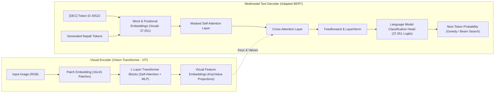
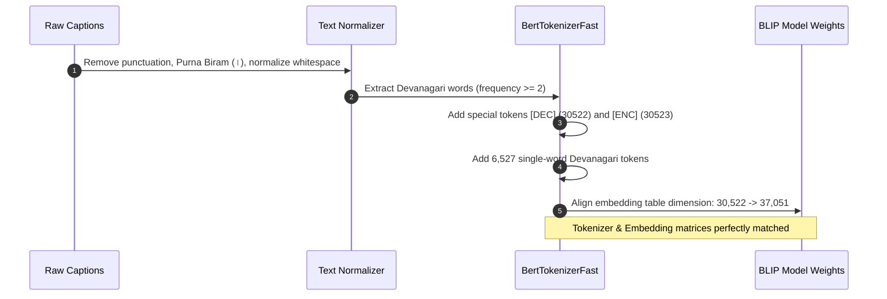

# 🇳🇵 Nepali Image Captioning with Adapted BLIP

An end-to-end deep learning project adapting Salesforce's **BLIP (Bootstrapping Language-Image Pre-training)** to generate accurate, natural, and context-aware captions for images in the **Nepali (नेपाली)** language.

---

## 📑 Table of Contents

- [Project Overview](#-project-overview)
- [Key Innovations & What's New](#-key-innovations--whats-new)
- [Overall Architecture & Flowcharts](#-overall-architecture--flowcharts)
  - [1. End-to-End System Pipeline](#1-end-to-end-system-pipeline)
  - [2. Model Architecture & Cross-Attention Mechanics](#2-model-architecture--cross-attention-mechanics)
  - [3. Tokenizer Adaptation Pipeline](#3-tokenizer-adaptation-pipeline)
- [Dataset Details & Preprocessing](#-dataset-details--preprocessing)
- [Experimental Results & Benchmarks](#-experimental-results--benchmarks)
- [How to Train, Run, and Test](#-how-to-train-run-and-test)
  - [Prerequisites & Installation](#prerequisites--installation)
  - [Inference on Images](#inference-on-images)
  - [Python API Usage](#python-api-usage)
  - [Training Workflow](#training-workflow)
- [Project Structure](#-project-structure)
- [Research Directions & Novel Q1 Publication Roadmap](#-research-directions--novel-q1-publication-roadmap)

---

## 🌟 Project Overview

Vision-Language Pre-training (VLP) models such as BLIP are pre-trained predominantly on massive English datasets (e.g., COCO, Visual Genome, LAION). Consequently, out-of-the-box models fail completely when tasked with low-resource languages written in non-Latin scripts, such as **Nepali (Devanagari script)**:

- English tokenizers segment Devanagari words into meaningless byte fragments or generic `[UNK]` tokens.
- Cross-attention layers and text decoders cannot map visual feature representations into coherent Nepali syntactic structures.

This project solves this bottleneck by taking **`Salesforce/blip-image-captioning-base`** and conducting **vocabulary adaptation**, **Devanagari diacritic preservation**, and **discriminative fine-tuning** on an image-level partitioned Nepali dataset. The resulting model produces fluent, grammatically sound Devanagari image descriptions with high semantic fidelity.

---

## 💡 Key Innovations & What's New

Unlike naive fine-tuning attempts, this project implements several specialized engineering and algorithmic techniques:

1. **Custom Devanagari Vocabulary Expansion (+6,527 Tokens)**:
   - Extracted high-frequency Devanagari words from the corpus (matching regex `^[\u0900-\u097F]+$`, frequency $\ge 2$, capped at 8,000 candidates).
   - Expanded the tokenizer vocabulary from 30,522 to **37,051 tokens**, drastically reducing the unknown token rate (`[UNK]`) and subword fragmentation.
2. **Preservation of Devanagari Diacritics (`strip_accents=False`)**:
   - Standard BERT tokenizers strip accent marks by default, corrupting Devanagari vowel signs (_matras_ such as `ा`, `ि`, `ी`, `ु`, `े`, `ो`, `ौ`, and halant `्`). Setting `strip_accents=False` preserves Devanagari orthography.
3. **BLIP Special Token ID Collision Protection**:
   - BLIP's pretrained decoder reserves token ID `30522` as `[DEC]` (decoder start/BOS token) and `30523` as `[ENC]`.
   - Naively injecting tokens would overwrite these critical IDs. The adaptation pipeline explicitly registers `[DEC]` and `[ENC]` in the tokenizer first, ensuring newly added Nepali words receive IDs $\ge 30524$.
4. **Differential / Two-Tier Learning Rates**:
   - **New Token Embeddings & LM Head**: Trained at a higher rate (`1e-4`) to learn meaningful semantic representations for the newly initialized Devanagari tokens quickly.
   - **Backbone (ViT Encoder + Transformer Layers)**: Trained at a conservative rate (`1e-5`) to avoid catastrophic forgetting of pre-trained visual-language grounding.
5. **Strict Image-Level Splitting (Zero Data Leakage)**:
   - In multi-caption datasets (5 captions per image), standard random splitting leaks identical images across splits. Splitting was performed strictly at the unique `image_id` level (6,000 train / 1,000 val / 1,000 test).
6. **Hardware & Training Efficiency**:
   - PyTorch Automated Mixed Precision (`torch.amp.GradScaler`, FP16) + Gradient Checkpointing enabled an effective batch size of 16 (batch size 4 $\times$ 4 gradient accumulation steps) inside standard Kaggle GPU limits.

---

## 📐 Overall Architecture & Flowcharts

### 1. End-to-End System Pipeline

```mermaid
flowchart TD
    subgraph DataPrep ["Data Preprocessing & Adaptation"]
        A[Flickr8k Nepali Dataset] --> B[Parse Captions & Normalization]
        B --> C[Clean Punctuation & Purna Biram '।']
        C --> D[Strict Image-Level Split: 6k Train / 1k Val / 1k Test]
        D --> E[Devanagari Vocabulary Extraction]
        E --> F[Reserve [DEC] & [ENC] Tokens]
        F --> G[Expand Tokenizer Vocab: 30,522 -> 37,051]
        G --> H[Resize BLIP Model Embeddings]
    end

    subgraph TrainingLoop ["Two-Tier Training & Evaluation"]
        H --> I[BLIP Architecture]
        I --> J[Differential Optimizer: 1e-4 Embeddings / 1e-5 Backbone]
        J --> K[Cosine Warmup Scheduler + FP16 AMP]
        K --> L[Forward Pass with Gradient Checkpointing]
        L --> M[Validation CIDEr & BLEU Evaluation]
        M -->|Best CIDEr Checkpoint| N[Save best_model/]
    end

    subgraph Inference ["Production Inference (caption.py)"]
        O[New Image: .jpg / .png] --> P[ViT Preprocessor 384x384]
        N --> Q[Loaded Nepali-BLIP Model]
        P --> Q
        Q --> R[Beam Search Decoding: beams=5, min_len=3, no_repeat_ngram=2]
        R --> S[Generated Nepali Caption + CSV/TXT Export]
    end
```

---

### 2. Model Architecture & Cross-Attention Mechanics



---

### 3. Tokenizer Adaptation Pipeline



---

## 📊 Dataset Details & Preprocessing

- **Dataset Source**: [`bipeshrajsubedi/flickr8k-nepali-dataset`](https://www.kaggle.com/datasets/bipeshrajsubedi/flickr8k-nepali-dataset)
- **Total Images**: 8,091 images with 5 reference captions per image (total ~40,455 caption records).
- **Partitioning**:
  - **Train**: 6,000 images (30,000 caption pairings)
  - **Validation**: 1,000 images (5,000 reference captions)
  - **Test**: 1,000 images (5,000 reference captions)
- **Text Normalization**:
  - Removed Nepali full-stops (`।`, `॥`) and standard punctuation so root words (e.g., `छ।` and `छ`) map to unified tokens.
  - Trimmed whitespace and enforced UTF-8 NFC normalization.

---

## 📈 Experimental Results & Benchmarks

The fine-tuned Nepali BLIP was benchmarked against the original pre-trained `Salesforce/blip-image-captioning-base` baseline on the 1,000 unseen test set images (5 reference captions each):

| Metric     | Pretrained BLIP (Zero-Shot) | Fine-Tuned Nepali BLIP | Relative Improvement |
| :--------- | :-------------------------: | :--------------------: | :------------------: |
| **BLEU-1** |          0.000152           |      **0.632619**      |    $+4,161\times$    |
| **BLEU-2** |          0.000155           |      **0.444737**      |    $+2,869\times$    |
| **BLEU-3** |          0.000132           |      **0.309105**      |    $+2,341\times$    |
| **BLEU-4** |          0.000110           |      **0.210359**      |    $+1,912\times$    |
| **CIDEr**  |          0.000256           |      **0.715605**      |    $+2,795\times$    |

### Training Convergence Progression

| Epoch | Train Loss | Val Loss | Val BLEU-1 | Val BLEU-4 | Val CIDEr  |       Status        |
| :---: | :--------: | :------: | :--------: | :--------: | :--------: | :-----------------: |
| **1** |   5.3137   |  3.6930  |   0.5605   |   0.1559   |   0.5339   |     Initialized     |
| **2** |   3.2690   |  3.1825  |   0.6171   |   0.2197   |   0.7117   |      Improved       |
| **3** |   2.6293   |  3.0531  |   0.6449   |   0.2383   |   0.7636   |      Improved       |
| **4** |   2.1910   |  3.0426  |   0.6448   |   0.2240   |   0.7743   |      Improved       |
| **5** |   1.8424   |  3.0675  |   0.6338   |   0.2242   | **0.7833** | **Best Checkpoint** |
| **6** |   1.5767   |  3.1187  |   0.6278   |   0.2118   |   0.7579   |    Patience 1/3     |
| **7** |   1.4061   |  3.1578  |   0.6329   |   0.2194   |   0.7706   |    Patience 2/3     |
| **8** |   1.3268   |  3.1694  |   0.6329   |   0.2156   |   0.7647   |      Completed      |

### Real Qualitative Predictions

- **Image: `chara.jpg` (Bird)**
  - _Generated:_ `हरियो र खैरो चरा हावामा उडिरहेको छ` _(A green and brown bird is flying in the air)_
- **Image: `2553550034_5901aa9d6c.jpg` (Rock Climber)**
  - _Generated:_ `सेतो टोपी लगाएको केटा चट्टान चढ्दै छ`
  - _Ground Truth:_ `सेतो टोपी लगाएको एउटा जवान केटा चट्टान चढिरहेको छ`
- **Image: `3678100844_e3a9802471.jpg` (Woman in green shirt)**
  - _Generated:_ `हरियो शर्ट लगाएकी एउटी महिला भीडमा उभिरहेकी छिन्`
  - _Ground Truth:_ `भीडमा बाहिर हरियो ज्याकेट र कालो सनग्लास लगाएकी महिला`

---

## 🚀 How to Train, Run, and Test

### Prerequisites & Installation

Clone the repository and install dependencies using `uv` (recommended) or standard `pip`:

```bash
# Clone the repository
git clone https://github.com/<your-username>/image_caption.git
cd image_caption

# Using uv (fastest)
uv sync

# Or using pip in a virtual environment
python -m venv .venv
source .venv/bin/activate
pip install torch torchvision transformers pillow nltk
```

---

### Inference on Images

Use `caption.py` to generate captions for individual images, multiple files, or entire folders:

```bash
# Test on a single image
uv run caption.py --model nepali_blip/best_model chara.jpg

# Test on multiple images
uv run caption.py --model nepali_blip/best_model chara.jpg humdog.avif oldhumans.jpg

# Process an entire folder of photos with custom beam width
uv run caption.py --model nepali_blip/best_model /path/to/photos/ --beams 5 --out results.csv
```

Outputs are printed to the terminal and automatically saved to:

- `captions.csv` (UTF-8 with BOM, directly viewable in Microsoft Excel / Google Sheets).
- `captions.txt` (Plaintext formatted list).

---

### Python API Usage

```python
import torch
from PIL import Image
from transformers import BertTokenizerFast, BlipForConditionalGeneration, BlipProcessor

MODEL_PATH = "nepali_blip/best_model"
device = torch.device("cuda" if torch.cuda.is_available() else "cpu")

# Load processor and force strip_accents=False to preserve Devanagari matras
processor = BlipProcessor.from_pretrained(MODEL_PATH)
processor.tokenizer = BertTokenizerFast.from_pretrained(MODEL_PATH, strip_accents=False)

# Load model
model = BlipForConditionalGeneration.from_pretrained(MODEL_PATH).to(device)
model.eval()

# Load image
image = Image.open("chara.jpg").convert("RGB")
inputs = processor(images=image, return_tensors="pt").to(device)

# Generate caption
with torch.no_grad():
    ids = model.generate(
        **inputs,
        num_beams=5,
        max_length=40,
        min_length=3,
        no_repeat_ngram_size=2,
        early_stopping=True,
    )

caption = processor.batch_decode(ids, skip_special_tokens=True)[0].strip()
print("Nepali Caption:", caption)
```

---

### Training Workflow

To retrain or run the notebook:

1. Open [`the-g-model.ipynb`](the-g-model.ipynb) on Kaggle with a GPU P100 or T4 $\times$ 2.
2. Link the Kaggle dataset `bipeshrajsubedi/flickr8k-nepali-dataset`.
3. Execute all cells. Checkpoints and evaluation metrics (`experiment.json`, `final_metrics.json`, `best_model/`) are exported to `/kaggle/working/nepali_blip/`.

---

## 🔬 Research Directions & Novel Q1 Publication Roadmap

### 1. Akshara-Grapheme Hierarchical Alignment via Optimal Transport (AG-OT)

- **Target Venue**: _ACL / EMNLP / IEEE TPAMI_
- **The Scientific Gap**: Standard subword tokenizers (WordPiece, Byte-BPE) were designed for Latin typography and fail catastrophically on Devanagari's non-concatenative, two-dimensional syllabic script (_Akshara_). Complex conjunct consonants (_Samyuktakshars_ e.g., `क्ष`, `त्र`, `ज्ञ`, `द्ध`) and vowel diacritics (_Matras_) cause extreme subword fragmentation, semantic dispersion, and high token entropy.
- **Proposed Novel Methodology**:
  - Design a **Hierarchical Grapheme-to-Akshara Tokenizer (HGAT)** that decomposes Devanagari text into consonant-vowel syllable matrices rather than linear character byte sequences.
  - Formulate an **Entropic Gromov-Wasserstein Optimal Transport (GW-OT)** loss $\mathcal{L}_{\text{GW}}$ that computes geometry-preserving soft alignments between non-local 2D visual patches from the ViT encoder $\mathbf{Z}_v \in \mathbb{R}^{N \times d}$ and the compositional Akshara structural embeddings $\mathbf{H}_s \in \mathbb{R}^{M \times d}$:
    $$\mathcal{L}_{\text{GW}}(C_v, C_s, T) = \sum_{i,j,k,l} |C_v(i,k) - C_s(j,l)|^2 T_{ij} T_{kl} - \epsilon H(T)$$
    where $C_v, C_s$ are intra-modal distance matrices and $T$ is the optimal transport plan.
  - **Theoretical Contribution**: Proves that non-Latin script tokenization can be formulated as a continuous manifold alignment problem rather than discrete vocabulary expansion.

---

### 2. Causal Attribution & Mitigation of Visual-Cultural Hallucination (VCHM)

- **Target Venue**: _CVPR / ICCV / IJCV_
- **The Scientific Gap**: Foundation vision backbones pre-trained on Western datasets (ImageNet, LAION, COCO) possess strong Western visual-cultural inductive biases. When shown culturally unique South Asian/Nepali entities (e.g., _Dhaka Topi_, _Pashupatinath Temple_, _Doko_, _Rato Machhindranath Chariot_), models exhibit severe **visual-cultural hallucination**, classifying them as "knitted beanie", "ancient castle ruins", or "wicker laundry basket".
- **Proposed Novel Methodology**:
  - Introduce **Counterfactual Visual-Cultural Intervention (CVCI)** using structural causal models (SCM):
    $$P(Y \mid do(X_c = x_c'))$$
    intervening on visual background cues while holding cultural foreground objects invariant.
  - Construct the first **Culturally-Diverse Devanagari Vision-Language Benchmark (NepalVL-Bench)** with $10\text{k}+$ expert-annotated pairs spanning architecture, indigenous artifacts, culinary traditions, and religious rites.
  - Propose a **Cultural Contrastive Regularizer ($\mathcal{L}_{\text{cult}}$)** penalizing Western concept drift through soft negative pairs derived from visual knowledge graphs (Wikidata/DBpedia Indic subgraphs).

---

### 3. Socio-Pragmatic & Honorific-Constrained Direct Preference Optimization (SPH-DPO)

- **Target Venue**: _EMNLP / NeurIPS_
- **The Scientific Gap**: Existing Reinforcement Learning from Human Feedback (RLHF) and Direct Preference Optimization (DPO) assume symmetric, egalitarian language semantics (typical of English). Nepali features a rigorous **four-tier socio-pragmatic honorific hierarchy**:
  $$\text{तँ (Low/Informal)} \prec \text{तिमी (Mid/Familiar)} \prec \text{तपाईँ (High/Respectful)} \prec \text{हजुर (Royal/Formal)}$$
  accompanied by strict Subject-Object-Verb (SOV) verb inflection and case-marking (_Vibhakti_) agreements. Current vision-to-text models commit jarring honorific discordance (e.g., addressing elderly subjects with informal verb inflections).
- **Proposed Novel Methodology**:
  - Formulate **Socio-Pragmatic Direct Preference Optimization (SPH-DPO)**, augmenting the Bradley-Terry preference model with an explicit visual-social relation constraint:
    $$\mathcal{L}_{\text{SPH-DPO}}(\theta) = -\mathbb{E}_{(x, y_w, y_l)} \left[ \log \sigma \left( \beta \log \frac{\pi_\theta(y_w \mid x)}{\pi_{\text{ref}}(y_w \mid x)} - \beta \log \frac{\pi_\theta(y_l \mid x)}{\pi_{\text{ref}}(y_l \mid x)} - \lambda \Omega_{\text{soc}}(y_w, y_l \mid x) \right) \right]$$
    where $\Omega_{\text{soc}}$ penalizes violations in demographic honorific concordance inferred from facial age, status, and interpersonal context in visual scene graph $x$.

---

### 4. Cross-Attention Manifold Distillation for Zero-Resource Bilingual Grounding

- **Target Venue**: _IEEE Transactions on Pattern Analysis and Machine Intelligence (TPAMI)_
- **The Scientific Gap**: High-quality bilingual caption pairs $(I, T_{\text{en}}, T_{\text{ne}})$ are extremely costly to collect. Naive machine translation yields semantic drift, unnatural phrasing, and loss of cultural context.
- **Proposed Novel Methodology**:
  - Develop **Cross-Lingual Attention Geometry Transfer (CL-AGT)**: A teacher-student framework where a frozen, state-of-the-art English Multimodal Large Language Model (e.g., LLaVA-NeXT / Qwen2.5-VL) acts as the cross-attention oracle.
  - Project the latent cross-attention heatmaps $A_{\text{teacher}} \in \mathbb{R}^{H \times W \times L_{\text{en}}}$ into a language-agnostic continuous visual topological space via **Riemannian manifold alignment**, training the low-resource Nepali student decoder to mirror the teacher's spatial attention trajectories without requiring parallel text:
    $$\mathcal{L}_{\text{topo}} = d_{\mathcal{M}} \left( \psi(A_{\text{student}}), \phi(A_{\text{teacher}}) \right)$$
  - Enables zero-shot transfer of complex compositional visual reasoning (spatial relations, counts, attribute binding) directly into Nepali caption generation.

---

### 5. Morpheme-Disentangled Evaluation Metric for Agglutinative & Inflected Scripts

- **Target Venue**: _ACL / EMNLP (Benchmark & Evaluation Track)_
- **The Scientific Gap**: Surface n-gram metrics (BLEU-1 to 4, ROUGE-L, CIDEr) penalize grammatically valid descriptions due to Nepali's agglutinative case-marker suffixes (_Vibhakti_: `-मा`, `-बाट`, `-ले`, `-लाई`, `-को/का/की`). For example, `कुकुर मैदानमा दौडिरहेको छ` and `कुकुर मैदान भित्र दौड्यो` share identical semantic meaning but suffer steep CIDEr penalties.
- **Proposed Novel Methodology**:
  - Engineer **Morpheme-CIDEr (M-CIDEr)** and **Indic-CLIPScore**:
    - Employs a neural morphological segmenter and dependency parser to decouple root semantic morphemes from case markers.
    - Weights semantic consensus by syntactic dependency graphs rather than naive n-gram frequency.
  - Conduct an extensive human evaluation study measuring correlation with native speaker psycholinguistic judgments (Spearman's $\rho$ and Pearson's $r$), establishing a standardized benchmark metric for Devanagari vision-language research.

---

### 6. Closed-Loop Visual-Verbal Cycle Consistency via Diffusion Inversion

- **Target Venue**: _CVPR / ICCV_
- **The Scientific Gap**: Autoregressive caption decoders generate tokens open-loop, with no self-correcting feedback mechanism. Early syntactic errors cascade into hallucinations.
- **Proposed Novel Methodology**:
  - Introduce **Cycle-Consistent Visual-Verbal Reflection (CVVR)**:
    1. The adapted Nepali BLIP decoder generates caption $\hat{Y}_{\text{ne}}$.
    2. A text-to-image diffusion model conditioned on multilingual text embeddings reconstructs a synthetic visual feature map $\hat{I} \sim \mathcal{D}(\hat{Y}_{\text{ne}})$.
    3. Compute a **Semantic Cycle Consistency Divergence**:
       $$\mathcal{L}_{\text{cycle}} = D_{\text{KL}}\left( f_{\text{ViT}}(I) \parallel f_{\text{ViT}}(\hat{I}) \right)$$
    4. Use the gradient of $\mathcal{L}_{\text{cycle}}$ at inference time via test-time guidance to iteratively refine decoding beams before finalizing the output caption.

---

### 🗺️ Publication Roadmap Timeline

| Phase  | Milestone                                                    | Expected Deliverable                                      |     Target Venue      |
| :----: | :----------------------------------------------------------- | :-------------------------------------------------------- | :-------------------: |
| **Q1** | Akshara Tokenizer (HGAT) + Optimal Transport Cross-Attention | Novel script-aware architecture & open-source tokenizer   |    **ACL / EMNLP**    |
| **Q2** | NepalVL-Bench Dataset + Cultural Hallucination Framework     | 10k culturally curated benchmark & causal debiasing study |    **CVPR / ICCV**    |
| **Q3** | Socio-Pragmatic DPO (SPH-DPO) & Morpheme-CIDEr metric        | Alignment framework with human evaluation study           |   **NeurIPS / ACL**   |
| **Q4** | Unified Cross-Lingual Manifold Distillation System           | End-to-end foundation model for South Asian VLP           | **IEEE TPAMI / IJCV** |
